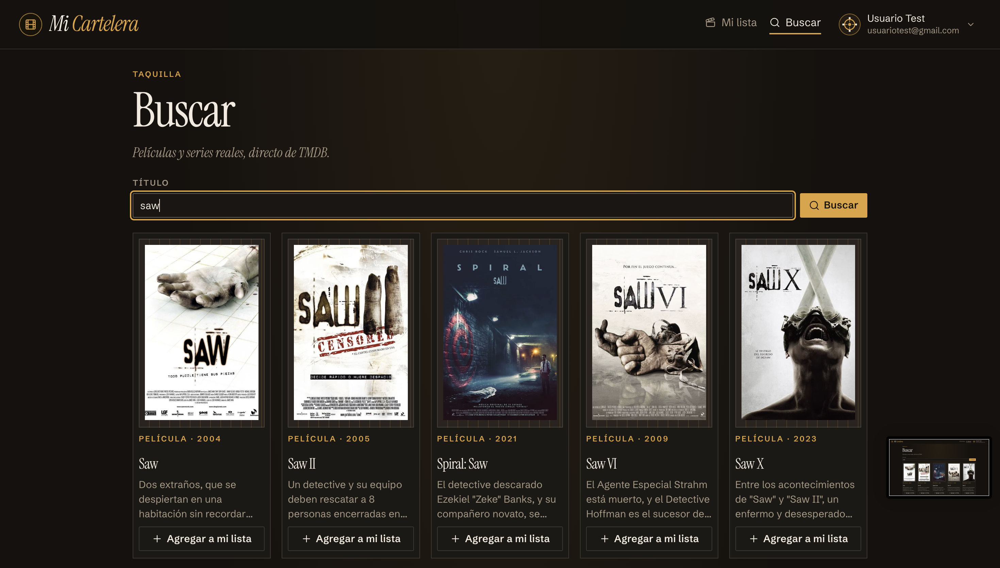
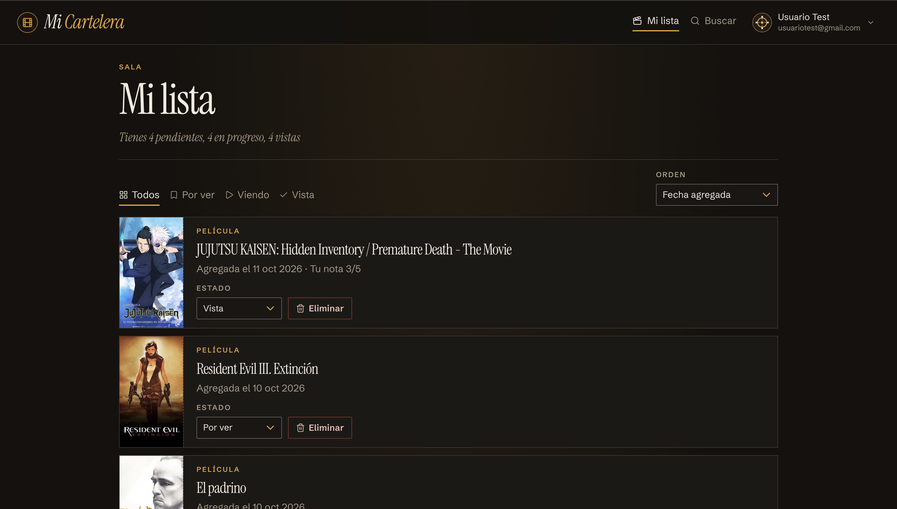
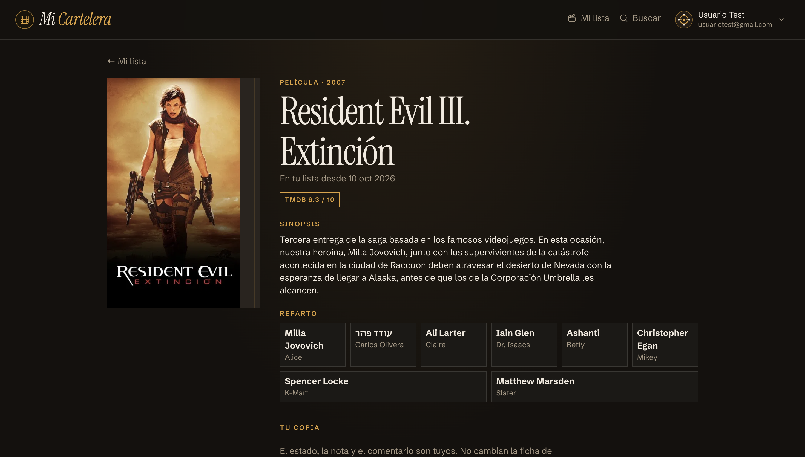
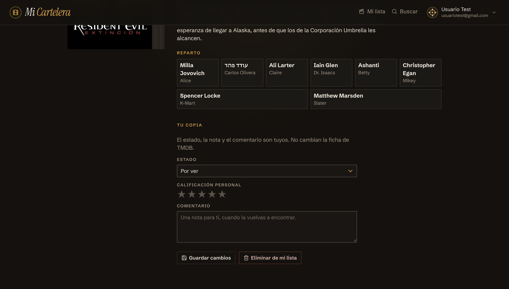
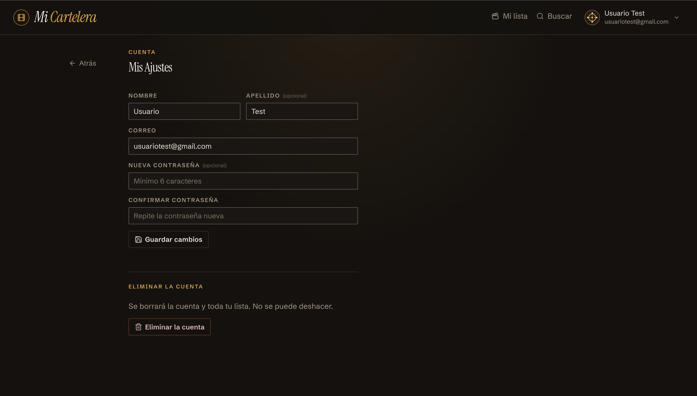

# Mi Cartelera Personal

Aplicación para llevar las películas y series que quieres ver, que estás viendo o que ya viste. La búsqueda usa The Movie Database (póster, año, sinopsis, reparto y nota oficial). Lo que guardas (estado, calificación del 1 al 5 y comentario) vive en tu cuenta personal. Las políticas de Row Level Security (RLS) impiden que otra persona lea o modifique tus filas.

La versión publicada está en [mi-cartelera-personal.vercel.app](https://mi-cartelera-personal.vercel.app).

Para probarla sin registrarte:

- Correo: `usuariotest@gmail.com`
- Contraseña: `test123`

## Stack Tecnológico

- React y TypeScript, con Vite
- React Router
- TMDB API v3
- Supabase Auth y PostgreSQL

## Estructura

```text
Mi-Cartelera-Personal/
├── public/
│   └── favicon.png
├── src/
│   ├── components/          // piezas de interfaz reutilizables
│   ├── context/             // sesión compartida por la app
│   ├── hooks/               // useAuth y useTitulo
│   ├── lib/                 // Supabase, TMDB y la lista
│   ├── pages/               // una pantalla por ruta
│   ├── types/               // tipos del catálogo
│   ├── App.tsx
│   ├── main.tsx
│   ├── index.css
│   └── vite-env.d.ts
├── index.html
├── package.json
├── vite.config.ts
├── tsconfig.json
├── eslint.config.js
└── .gitignore
```

## Instalación

Desde esta carpeta:

```bash
npm install
```

Crea un archivo `.env` en la raíz del proyecto con estas tres variables:

```bash
VITE_SUPABASE_URL=
VITE_SUPABASE_ANON_KEY=
VITE_TMDB_API_KEY=
```

| Variable                 | Dónde se obtiene                                                        |
| ------------------------ | ----------------------------------------------------------------------- |
| `VITE_SUPABASE_URL`      | Project Settings → API, en tu proyecto de Supabase                      |
| `VITE_SUPABASE_ANON_KEY` | La clave `anon` / `public` del mismo lugar. No uses la `service_role`   |
| `VITE_TMDB_API_KEY`      | API Key v3 en [themoviedb.org](https://www.themoviedb.org/settings/api) |

En una app de Vite estas variables viajan en el JavaScript del navegador. La clave `anon` está pensada para eso. Quien protege los datos es Row Level Security.

```bash
npm run dev
```

Los tests de la regla de Noche de película:

```bash
npm test
```

Antes de guardar una noche en una base nueva, ejecuta en el SQL Editor, en este orden, `supabase/migrations/20261111_noche_de_pelicula.sql` y `supabase/migrations/20261112_noche_opcionales.sql`. Si el proyecto está en pausa, restáuralo primero.

## Noche de película

Con la sesión iniciada, Noche pregunta cuántos minutos libres tienes (un entero de 30 a 600) y muestra qué películas «por ver» caben. Entre una y la siguiente se cuentan 10 minutos de pausa: con n películas hay n − 1 pausas, y una sola no suma pausa. Una noche que ocupa exactamente el tiempo disponible sí cabe.

La sesión se guarda con nombre. No cambia el estado de las películas. Se puede consultar o borrar, no editar. Si quitas de tu lista una película que ya estaba en una noche, la noche conserva el título y la duración y avisa que ya no está en la lista.

La regla vive en `src/dominio/noche.ts` y no llama a la red. TMDB entra solo por `src/lib/tmdb.ts` (`obtenerDuracion` y `obtenerFichaNoche`). Supabase entra solo por `src/lib/sesiones.ts`.

En Noche también se puede filtrar por género, pedir «Llenar la noche» y, en una sesión ya guardada, marcar «Ya la vi». Ese último gesto pasa a vista las películas que sigan en la lista. Guardar, por sí solo, no cambia el estado. La base rechaza una noche cuya suma, con las pausas, supere el tiempo.

La app publicada: https://rmandors.github.io/Mi-Cartelera-Personal/

## Harness

El agente lee `AGENTS.md`. `CLAUDE.md` importa ese archivo. La skill `/commit` está en `.claude/skills/commit/SKILL.md` y no se invoca sola (`disable-model-invocation`). Antes del commit invoca al subagente `.claude/agents/revisor.md`. Si no hay bloqueo, deja `.git/REVISOR_OK`; el hook `PreToolUse` niega el `git commit` del agente sin esa marca. Un commit escrito a mano en la terminal no pasa por ese hook. Después de escribir o editar un archivo, el hook `PostToolUse` corre `.claude/hooks/formatear.sh`, que formatea ese archivo con Prettier. La configuración es `.prettierrc`.

GitHub Pages se construye con `.github/workflows/pages.yml`. Las claves van en los secretos del repositorio, no en el código.

Ninguna funcionalidad nueva entra sin spec en `docs/specs/`. El orden de esta entrega está en el historial: harness, estado inicial, diseño, PRD, backlog, spec y, después, un commit por ticket.

## Capturas

### Login


Pantalla de entrada. Pide correo y contraseña, y enlaza al registro. Sin sesión no se puede abrir el resto de la app.

### Registro


Registro de cuenta. Contiene tanto campos obligatorios como opcionales. Abajo, el enlace para volver al login.

### Búsqueda



Resultados de TMDB: póster, tipo, año y título. Desde cada tarjeta se agrega el título a la lista.

### Mi lista



Títulos guardados, con el resumen de pendientes, en progreso y vistas, el filtro por estado y el orden por fecha o por calificación.

### Ficha




Póster, sinopsis, reparto y nota de TMDB, más el estado, las estrellas del 1 al 5 y el comentario personal.

### Ajustes



Cambio de nombre, apellido, correo o contraseña, así como la opción de eliminar la cuenta.

## Atribución

Los pósteres, la sinopsis, el reparto, el año y la nota oficial salen de la API de [The Movie Database](https://www.themoviedb.org/). Este producto usa la API de TMDB, pero no está avalado ni certificado por TMDB. Esos datos y esas imágenes siguen siendo de sus titulares. La app no los modifica.

Lo que guardas en tu cuenta (estado, estrellas y comentario) vive en Supabase y no se envía a TMDB. El uso de la API se rige por sus [términos](https://www.themoviedb.org/api-terms-of-use).
