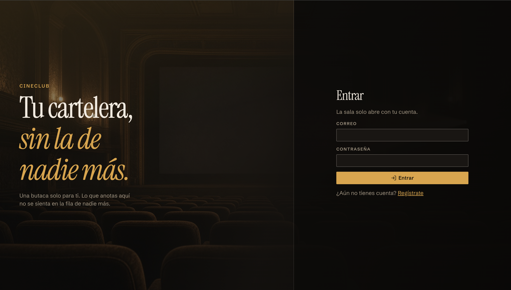
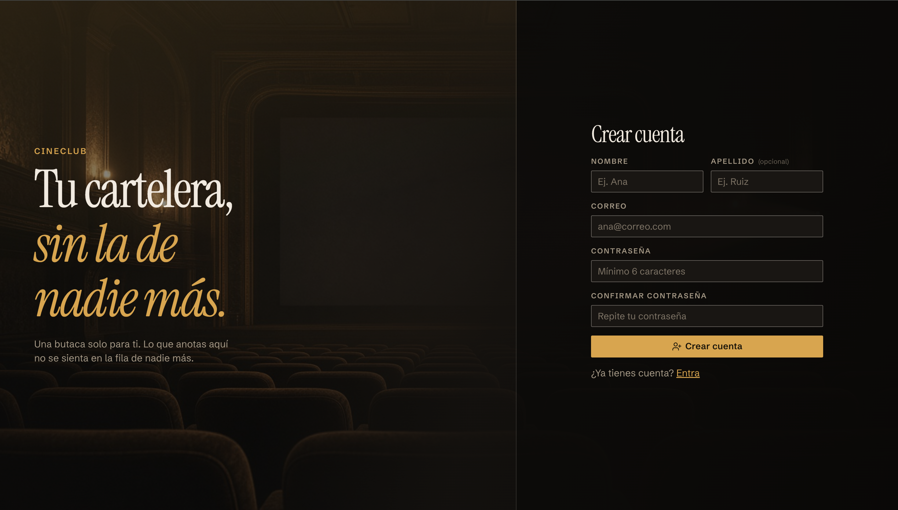
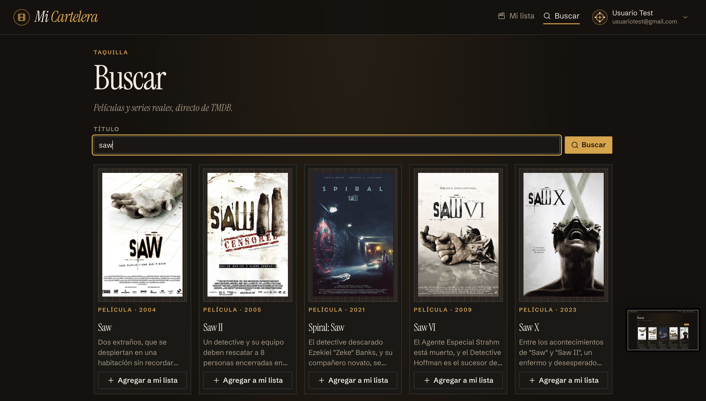
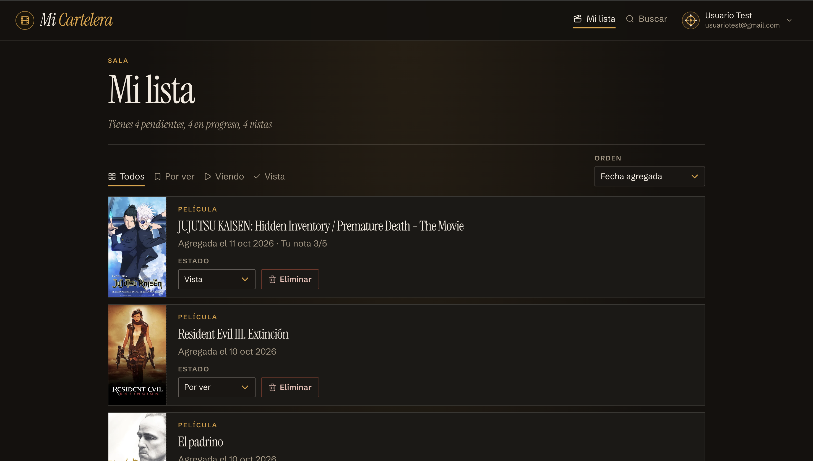
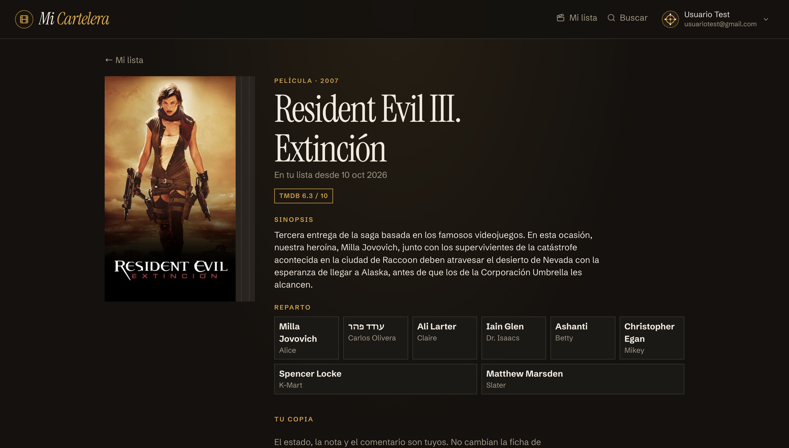
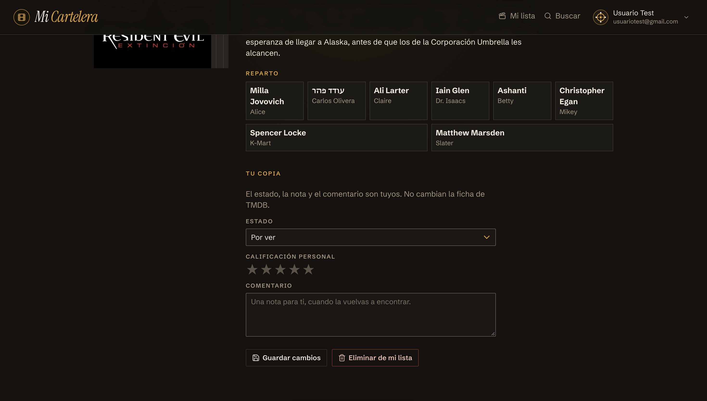
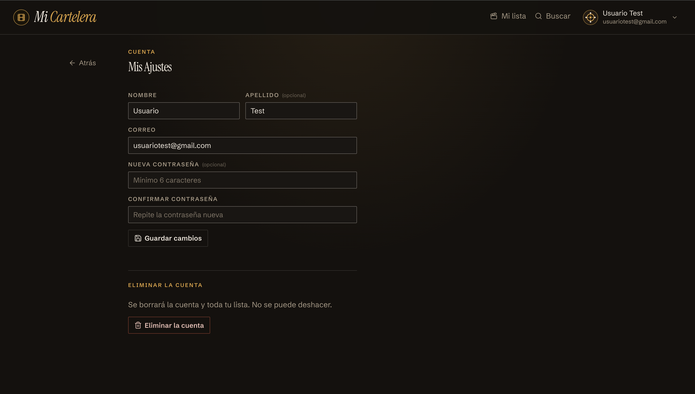

# Mi Cartelera Personal

Aplicación para llevar las películas y series que quieres ver, que estás viendo o que ya viste. La búsqueda usa The Movie Database (póster, año, sinopsis, reparto y nota oficial). Lo que guardas (estado, calificación del 1 al 5 y comentario) vive en tu cuenta personal. Las políticas de Row Level Security (RLS) impiden que otra persona lea o modifique tus filas.

La versión publicada está en [mi-cartelera-personal.vercel.app](https://mi-cartelera-personal.vercel.app).

Para probarla sin registrarte:

- Correo: `usuariotest@gmail.com`
- Contraseña: `test123`

## Stack Tecnológico

- React y TypeScript, con Vite
- React Router
- TMDB API v3
- Supabase Auth y PostgreSQL

## Estructura

```text
Mi-Cartelera-Personal/
├── public/
│   └── favicon.png
├── src/
│   ├── components/          // piezas de interfaz reutilizables
│   ├── context/             // sesión compartida por la app
│   ├── hooks/               // useAuth y useTitulo
│   ├── lib/                 // Supabase, TMDB y la lista
│   ├── pages/               // una pantalla por ruta
│   ├── types/               // tipos del catálogo
│   ├── App.tsx             
│   ├── main.tsx             
│   ├── index.css            
│   └── vite-env.d.ts        
├── index.html
├── package.json
├── vite.config.ts
├── tsconfig.json
├── eslint.config.js
└── .gitignore
```

## Instalación

Desde esta carpeta:

```bash
npm install
```

Crea un archivo `.env` en la raíz del proyecto con estas tres variables:

```bash
VITE_SUPABASE_URL=
VITE_SUPABASE_ANON_KEY=
VITE_TMDB_API_KEY=
```

| Variable | Dónde se obtiene |
| --- | --- |
| `VITE_SUPABASE_URL` | Project Settings → API, en tu proyecto de Supabase |
| `VITE_SUPABASE_ANON_KEY` | La clave `anon` / `public` del mismo lugar. No uses la `service_role` |
| `VITE_TMDB_API_KEY` | API Key v3 en [themoviedb.org](https://www.themoviedb.org/settings/api) |

En una app de Vite estas variables viajan en el JavaScript del navegador. La clave `anon` está pensada para eso. Quien protege los datos es Row Level Security.

```bash
npm run dev
```

## Capturas

### Login



Pantalla de entrada. Pide correo y contraseña, y enlaza al registro. Sin sesión no se puede abrir el resto de la app.

### Registro



Registro de cuenta. Contiene tanto campos obligatorios como opcionales. Abajo, el enlace para volver al login.

### Búsqueda



Resultados de TMDB: póster, tipo, año y título. Desde cada tarjeta se agrega el título a la lista.

### Mi lista



Títulos guardados, con el resumen de pendientes, en progreso y vistas, el filtro por estado y el orden por fecha o por calificación.

### Ficha




Póster, sinopsis, reparto y nota de TMDB, más el estado, las estrellas del 1 al 5 y el comentario personal.

### Ajustes



Cambio de nombre, apellido, correo o contraseña, así como la opción de eliminar la cuenta.

## Atribución

Los pósteres, la sinopsis, el reparto, el año y la nota oficial salen de la API de [The Movie Database](https://www.themoviedb.org/). Este producto usa la API de TMDB, pero no está avalado ni certificado por TMDB. Esos datos y esas imágenes siguen siendo de sus titulares. La app no los modifica.

Lo que guardas en tu cuenta (estado, estrellas y comentario) vive en Supabase y no se envía a TMDB. El uso de la API se rige por sus [términos](https://www.themoviedb.org/api-terms-of-use).